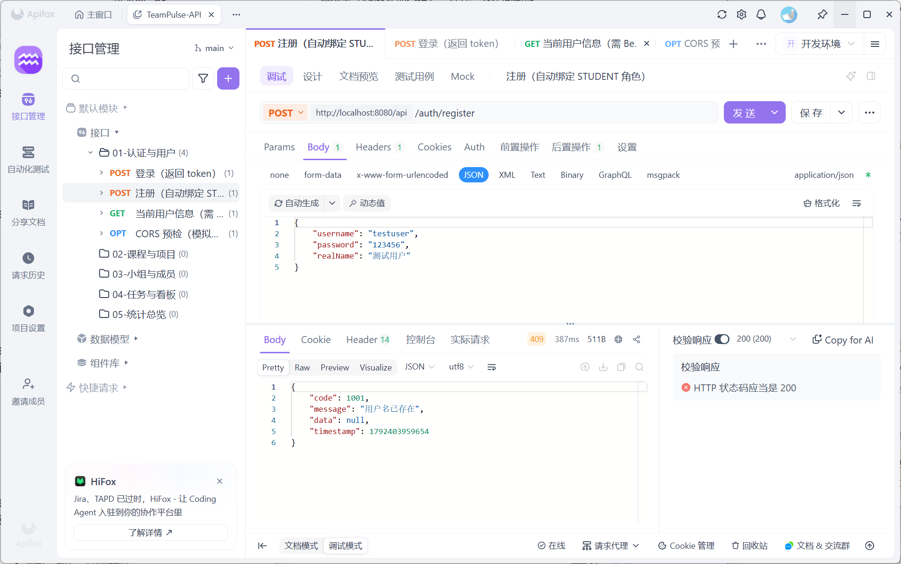
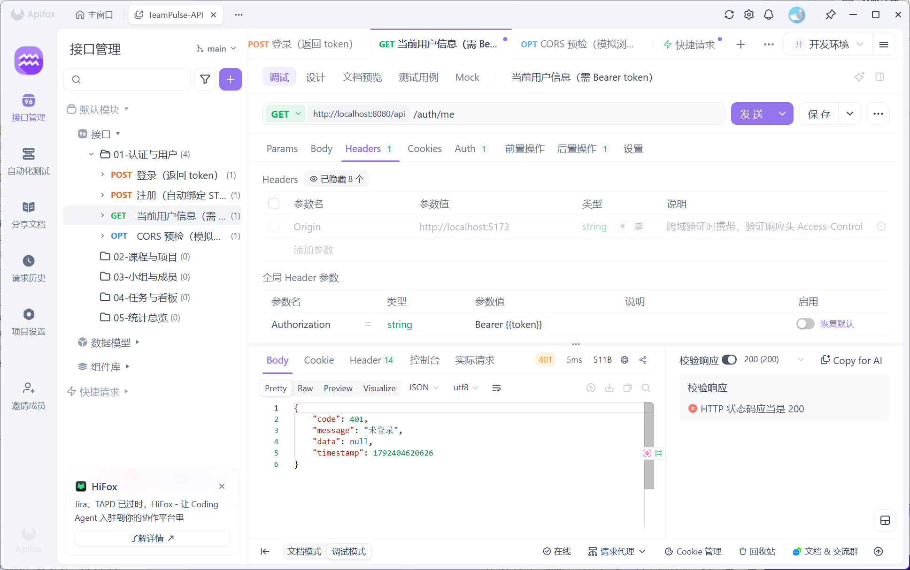
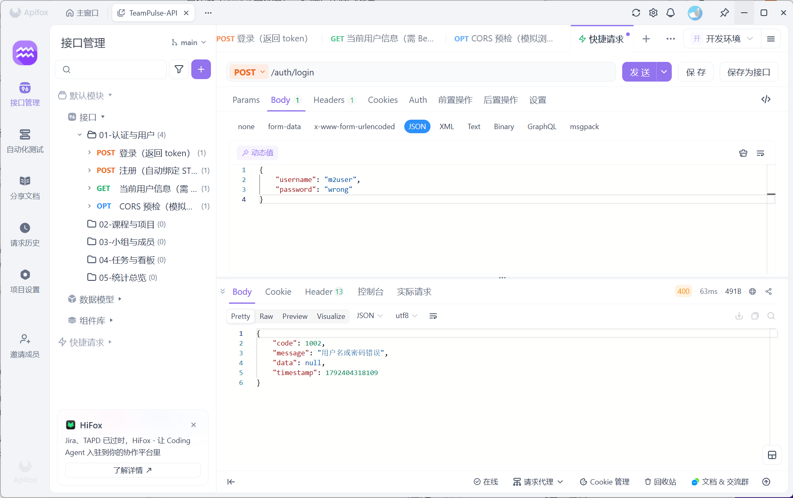
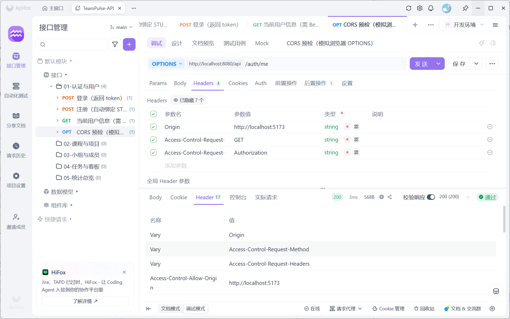

# 后端自测记录（M2 里程碑验收证据）

> 对应《前置任务》5.11 P2-11「后端自测与用例留档」。
> 本文件作为 M2 里程碑的验收证据留档；每步跑完后填写「实测结果」，并附截图或执行记录（二选一）。
>
> **推荐用零配置文件**：导入 `docs/test/apifox-self-test.openapi.json`（内置 dev token，对应 testuser），/auth/me 无需任何 token 配置即可直接发送。

## 环境信息

| 项 | 值 |
| --- | --- |
| 后端地址 | `http://localhost:8080/api`（以 `application-dev.yml` 实际端口为准；本地若为 11007 则用 `http://localhost:11007/api`） |
| 数据库 | `teampulse`（`schema.sql` + `seed.sql` 已执行） |
| 测试工具 | Apifox |
| 测试人 / 日期 | 成员 A / ____________ |

## 用例清单

### 用例 1：注册新用户
- 请求：`POST /auth/register`，body `{"username":"m2user","password":"123456","realName":"测试用户"}`
- 预期：`200`，`code=200`，`data=null`
- 实测：

### 用例 2：登录拿 Token
- 请求：`POST /auth/login`，body `{"username":"m2user","password":"123456"}`
- 预期：`200`，`code=200`，`data.token` 非空；后置操作自动写入环境变量 `token`
- 实测：

### 用例 3：带 Token 调 /auth/me（正向链路）
- 请求：`GET /auth/me`。**使用内置 token 版**：导入 `apifox-self-test.openapi.json`，Authorization 已预填 `Bearer <dev token>`（对应 testuser id=2）
- 预期：`200`，`code=200`，`data.username=testuser`、`data.roles=["STUDENT"]`
- 实测：⬜ 待重新截图（原 `apifox带Token调_*.png` 是 `{{token}}` 未赋值导致的 401，属配置问题，非后端缺陷）

### 用例 4：不带 Token 调 /auth/me（失败分支）
- 请求：`GET /auth/me`，把 Authorization 那一行**取消勾选**后发送
- 预期：`401`，`code=401`
- 实测：

### 用例 5：错密码登录（失败分支）
- 请求：`POST /auth/login`，body `{"username":"m2user","password":"wrong"}`
- 预期：`400`，`code=1002`，`message=用户名或密码错误`
- 实测：

### 用例 6：CORS 预检
- 请求：`OPTIONS /auth/me`，Headers：`Origin: http://localhost:5173`、`Access-Control-Request-Method: GET`、`Access-Control-Request-Headers: Authorization`
- 预期：`200`，响应头 `Access-Control-Allow-Origin: http://localhost:5173`
- 实测：

## 结论

- [ ] 全部 6 步通过
- 备注：____________
